<p align="center">
  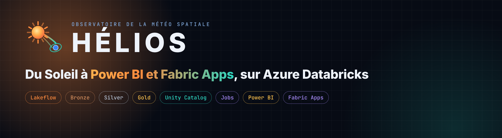
</p>

<p align="center">
  
  
  
  
  
</p>

<p align="center">
  <b>Un lakehouse de production qui suit la météo de l'espace, du Soleil jusqu'à la Terre :</b><br>
  trois sources scientifiques publiques, 94 ans d'histoire, un pipeline incrémental contrôlé chaque matin,<br>
  un rapport Power BI et une application Fabric Apps.
</p>

<p align="center">
  <a href="docs/HELIOS_guide_Databricks.pdf"><b>📘 Guide pas à pas (PDF, 10 pages)</b></a> ·
  <a href="#-démarrage-rapide"><b>🚀 Démarrage rapide</b></a> ·
  <a href="#-architecture"><b>🏗️ Architecture</b></a> ·
  <a href="#-modèle-sémantique"><b>🧠 Modèle sémantique</b></a> ·
  <a href="#-structure-du-dépôt"><b>🗂️ Structure du dépôt</b></a>
</p>

---

## 📸 Aperçu

### L'application Fabric Apps, en visite rapide

<p align="center">
  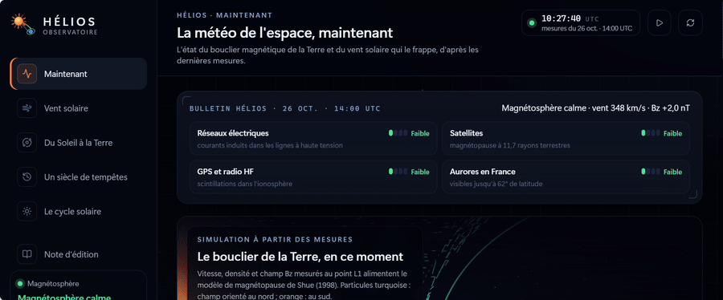
</p>

### Le bouclier magnétique de la Terre, calculé à partir des mesures

<p align="center">
  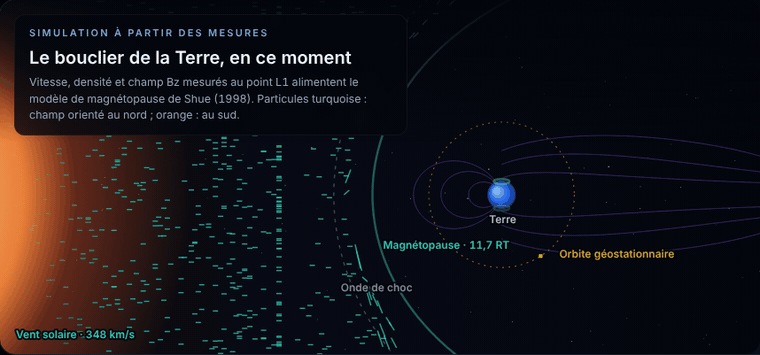
</p>

> La vitesse, la densité et le champ Bz mesurés à 1,5 million de km de la Terre alimentent le modèle de magnétopause de Shue (1998). Particules turquoise : champ orienté au nord ; orange : champ au sud, la porte s'ouvre.

### Le rapport Power BI

<p align="center">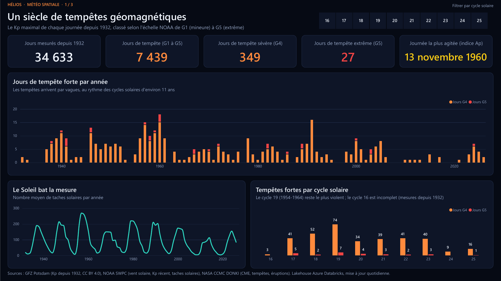</p>

| Du Soleil à la Terre | Le vent solaire en direct |
| :---: | :---: |
| 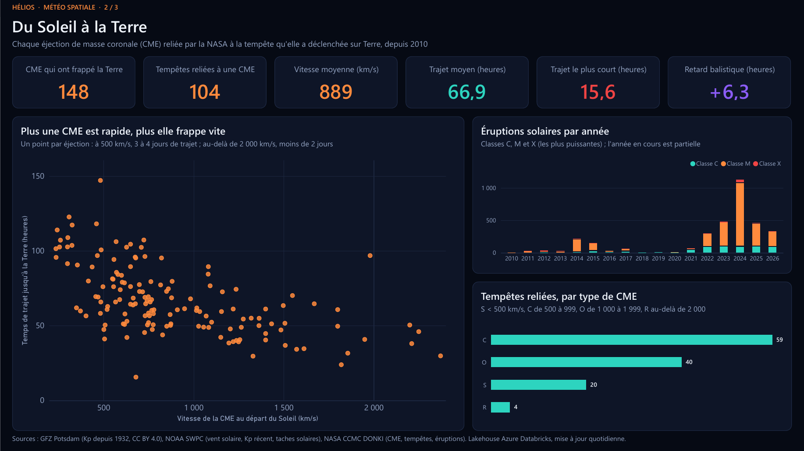 | 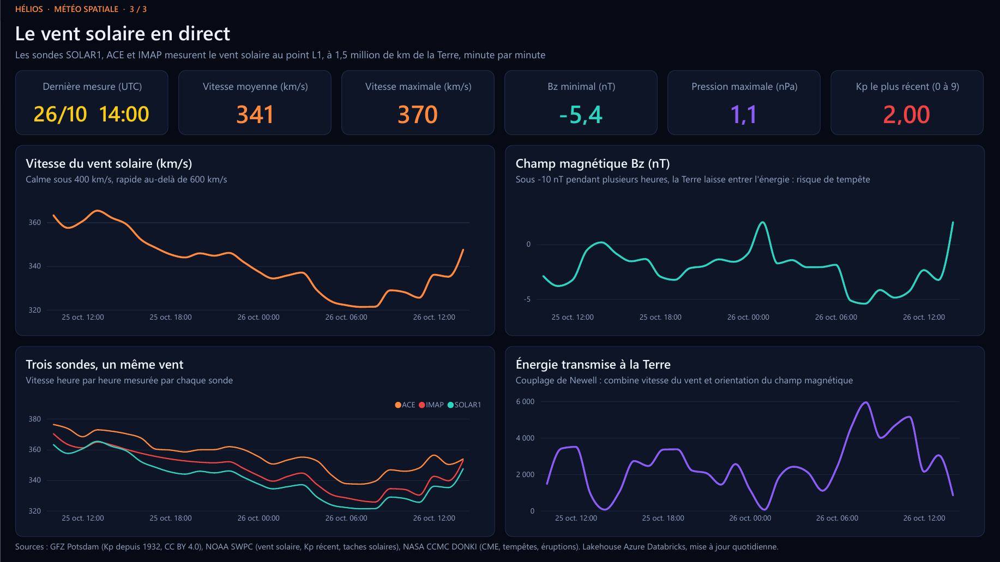 |

---

## 📊 Résultats clés

| Indicateur | Valeur | Ce que cela veut dire |
| --- | ---: | --- |
| Jours de mesure de l'indice Kp | **34 633** | De 1932 à aujourd'hui, sans interruption (GFZ Potsdam) |
| Jours de tempête géomagnétique (G1 à G5) | **7 439** | Environ un jour sur cinq |
| Jours de tempête sévère (G4) | **349** | Kp de 8- à 8+ |
| Jours de tempête extrême (G5) | **27** | Kp 9, le sommet de l'échelle NOAA |
| Journée la plus agitée depuis 1932 | **13 novembre 1960** | Indice Ap de 280 |
| Éjections de masse coronale reliées à une tempête | **148** | Catalogue NASA DONKI, depuis 2010 |
| Vitesse moyenne de ces éjections | **889 km/s** | Le trajet Soleil Terre dure en moyenne près de trois jours |
| Éruptions solaires recensées | **3 397** | Dont 156 de classe X, les plus puissantes |
| Fichiers bruts ingérés à la reprise historique | **≈ 315** | 5 NOAA, ≈ 309 NASA, 1 GFZ |
| Coût de construction complète mesuré | **≈ 17 USD** | Prix catalogue Databricks, reprise historique comprise |

---

## 💼 Impact

La météo spatiale n'est pas qu'un sujet d'astronome : une tempête G5 perturbe les réseaux électriques, le GPS, la radio haute fréquence et les satellites. HÉLIOS en fait un sujet de données :

- **Relier la cause et l'effet.** Chaque tempête est reliée à l'éjection solaire qui l'a provoquée, avec le temps de trajet réel et l'écart au calcul balistique.
- **Mettre le présent en perspective.** Le Kp des dernières heures s'inscrit dans une série continue depuis 1932, et le cycle solaire en cours est comparé aux 24 précédents.
- **Lire la cause en direct.** Le couplage de Newell estime l'énergie que le vent solaire injecte dans le bouclier terrestre, avant même que le Kp ne réagisse.
- **Prouver chaque chiffre.** Lignée automatique, contrôles qualité mesurés, sources et licences tracées jusqu'au fichier d'origine.

---

## 🧭 Résumé

HÉLIOS est un projet de data engineering de bout en bout, construit sur **Azure Databricks** :

1. Un **collecteur Python** interroge chaque matin trois sources publiques (NOAA SWPC, NASA CCMC DONKI, GFZ Potsdam) et dépose chaque réponse, intacte et horodatée, dans un **volume Unity Catalog**.
2. Un **pipeline Lakeflow déclaratif** transforme ces fichiers en **19 tables Delta** selon l'architecture médaillon : bronze (copie fidèle), silver (nettoyé, dédoublonné, historisé), gold (une question, une table).
3. Un **job** enchaîne collecte, transformation et contrôle de fraîcheur, et prévient par e-mail en cas d'échec.
4. **Unity Catalog** gouverne l'ensemble : droits au moindre privilège, tags de source et de licence, lignée, qualité et coût mesurés.
5. La couche gold alimente un **tableau de bord AI/BI**, un **Genie Agent** en français, un **modèle sémantique Power BI** en étoile (31 mesures DAX), un **rapport Power BI** et une **application Fabric Apps** qui lit ce modèle en DAX.

> 📘 Le [guide pas à pas](docs/HELIOS_guide_Databricks.pdf) refait tout le projet en dix étapes, avec pour chacune l'objectif, les gestes, le résultat attendu et la raison du choix d'architecture.

---

## 🔄 Pipeline

| Couche | Ce qui s'y passe | Techniques Databricks | Fichier |
| --- | --- | --- | --- |
| **Atterrissage** | Chaque réponse d'API est emballée avec sa source, son URL, sa date de collecte et une empreinte SHA-256 | Notebook serverless, volume Unity Catalog, nouvelles tentatives avec attente exponentielle | [`01_collecteur.py`](01_notebooks/01_collecteur.py) |
| 🟤 **Bronze** | Trois streaming tables, une ligne par fichier, seuls les fichiers nouveaux sont lus | Auto Loader, schéma imposé, `_metadata.file_path`, `expect_or_fail` | [`01_bronze.py`](02_pipeline/transformations/01_bronze.py) |
| ⚪ **Silver** | Neuf tables : JSON décodé, mesures contrôlées, doublons fusionnés, révisions NASA historisées | `from_json`, `explode`, `posexplode`, expectations, AUTO CDC type 1 et type 2 | [`02`](02_pipeline/transformations/02_silver_noaa.py) · [`03`](02_pipeline/transformations/03_silver_gfz.py) · [`04`](02_pipeline/transformations/04_silver_donki.py) |
| 🟡 **Gold** | Sept vues matérialisées en SQL, chacune répond à une question | Couplage de Newell, pression dynamique, transit balistique, classes NOAA | [`05_gold.sql`](02_pipeline/transformations/05_gold.sql) |
| 🟣 **Orchestration** | Collecter, transformer, contrôler, chaque jour à 06:17 | Job Lakeflow, une nouvelle tentative, alerte e-mail | [`02_controle.py`](01_notebooks/02_controle.py) |

<details>
<summary><b>Les quatre pièges des sources, et leur réponse dans le code</b></summary>

| Source | Piège | Réponse |
| --- | --- | --- |
| NOAA SWPC | Trois sondes (SOLAR1, ACE, IMAP) mesurent la même minute ; chaque collecte couvre 24 heures qui se recouvrent | Clé `(time_tag, sonde)` et AUTO CDC type 1 : une seule ligne par minute et par sonde |
| NASA DONKI | Les fiches CME sont révisées après coup (`versionId`) | AUTO CDC type 2 : chaque révision devient une ligne datée (`__START_AT`, `__END_AT`) |
| NASA DONKI | L'API refuse toute période de plus de 60 jours | Le collecteur découpe la période en fenêtres de 60 jours, avec une pause d'une seconde |
| GFZ Potsdam | Texte à colonnes, 8 valeurs de Kp par ligne, `-1` pour « manquant » | `split`, `posexplode` et `timestampadd` déplient la journée en 8 tranches de 3 heures |

</details>

<details>
<summary><b>Les sept tables gold</b></summary>

| Table gold | Une ligne par | La question à laquelle elle répond |
| --- | --- | --- |
| `vent_solaire_horaire` | heure | Le vent charge-t-il la magnétosphère ? Bz sud, pression, couplage de Newell |
| `comparaison_sondes` | heure et sonde | SOLAR1, ACE et IMAP voient-elles le même vent ? |
| `kp_3h` | tranche de 3 h | Kp de 1932 à maintenant en une série : GFZ pour l'histoire, NOAA pour les dernières heures |
| `dim_cycles_solaires` | cycle | Dans quel cycle solaire (16 à 25) tombe chaque jour ? |
| `journal_geomagnetique` | jour | Kp max, classe NOAA, Ap, taches solaires, flux F10.7 et cycle du jour |
| `du_soleil_a_la_terre` | tempête et CME | Combien d'heures entre le départ d'une CME et la tempête ? |
| `eruptions_mensuelles` | mois et classe | Combien d'éruptions A, B, C, M, X par mois ? |

</details>

---

## 🧬 Lignée

<p align="center">
  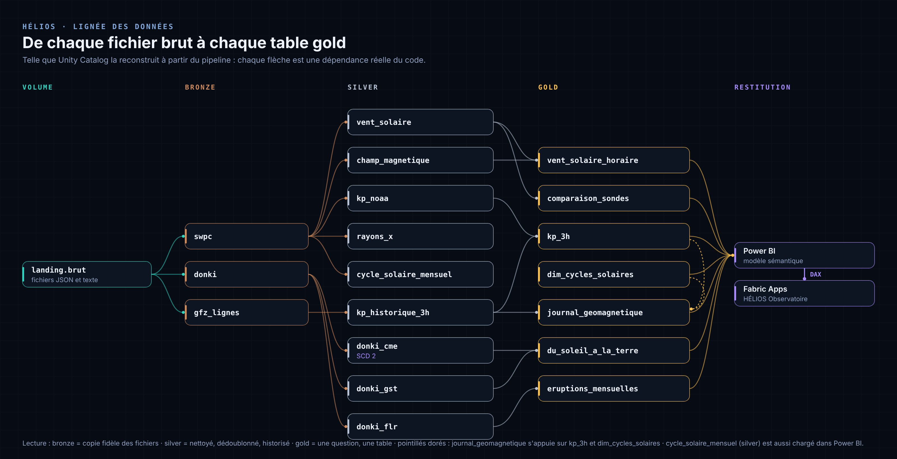
</p>

Unity Catalog reconstruit cette lignée sans une ligne de code, en observant le pipeline : **Catalog → helios → gold → `du_soleil_a_la_terre` → Lineage → See lineage graph**. Chaque chiffre affiché dans Power BI ou dans l'application remonte ainsi jusqu'au fichier, à l'URL et à la minute de collecte qui l'ont produit.

---

## 🏗️ Architecture

<p align="center">
  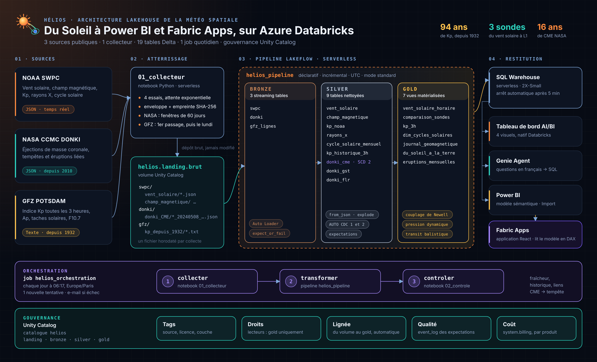
</p>

| Choix | Pourquoi |
| --- | --- |
| **Déposer des fichiers, puis les charger** | On garde la preuve brute de chaque réponse, on peut tout recharger si une règle change, et une panne d'un côté ne bloque pas l'autre |
| **Une enveloppe commune pour toutes les API** | Une seule fonction de lecture en bronze, et chaque ligne reste traçable jusqu'à l'appel qui l'a produite |
| **Streaming tables et Auto Loader** | Chaque passage quotidien ne lit que les fichiers du jour : on ne paie jamais deux fois l'historique |
| **AUTO CDC type 2 sur les CME** | Les révisions de la NASA sont conservées et datées, au lieu d'écraser l'histoire |
| **Vues matérialisées en gold** | Power BI lit des tables déjà prêtes : chargement rapide, entrepôt SQL presque au repos |
| **Serverless en mode standard, entrepôt 2X-Small à arrêt automatique** | Démarrage un peu plus lent, coût nettement plus bas |
| **Power BI en mode Import** | L'entrepôt ne se réveille qu'aux actualisations, jamais pendant la navigation |
| **Fabric Apps sur le modèle sémantique** | L'application lit les mêmes mesures que le rapport, avec les droits Fabric de la personne connectée |

---

## 🧠 Modèle sémantique

<p align="center">
  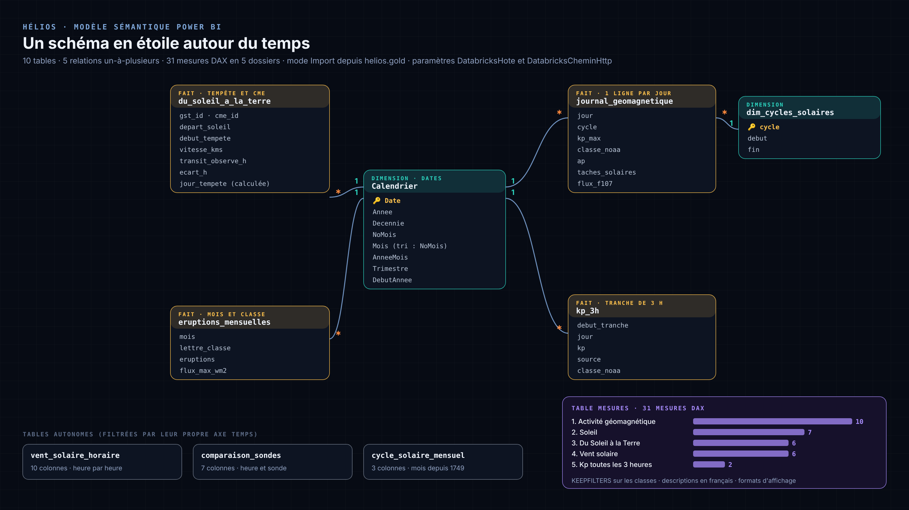
</p>

Le modèle **HELIOS_Meteo_Spatiale** est la source unique du rapport Power BI et de l'application Fabric Apps : les mêmes mesures, les mêmes règles, partout.

| | |
| --- | --- |
| **Format** | Projet PBIP : modèle en TMDL, rapport en PBIR, tout se relit dans Git |
| **Schéma** | En étoile : un `Calendrier` depuis 1932 partagé par quatre tables de faits, plus `dim_cycles_solaires` |
| **Relations** | 5 relations un-à-plusieurs, filtre à sens unique, de la dimension vers le fait |
| **Mesures** | 31 mesures DAX en 5 dossiers, avec formats, descriptions en français et `KEEPFILTERS` sur les classes NOAA |
| **Connexion** | Connecteur Azure Databricks, mode Import, paramètres `DatabricksHote` et `DatabricksCheminHttp` |
| **Publication** | Espace Fabric, identifiants OAuth2, actualisation planifiée après le job Databricks |

<details>
<summary><b>Quelques mesures clés</b></summary>

```dax
Jours de tempête forte (G4 ou G5) =
CALCULATE ( COUNTROWS ( journal_geomagnetique ),
            KEEPFILTERS ( journal_geomagnetique[classe_noaa] IN { "G4", "G5" } ) )

Journée la plus agitée =
VAR _top = TOPN ( 1, journal_geomagnetique,
                  journal_geomagnetique[ap], DESC, journal_geomagnetique[kp_max], DESC )
RETURN FORMAT ( MAXX ( _top, journal_geomagnetique[jour] ), "d mmmm yyyy", "fr-FR" )

Kp le plus récent =
VAR _derniere = MAX ( kp_3h[debut_tranche] )
RETURN CALCULATE ( MAX ( kp_3h[kp] ), kp_3h[debut_tranche] = _derniere )
```

</details>

Tables, relations, les 31 mesures et la procédure d'ouverture et de publication : [`07_power_bi/`](07_power_bi/).

---

## 📱 L'application Fabric Apps

Six écrans, une salle de contrôle de la météo spatiale. Chaque graphique se copie en image, se télécharge en PNG ou exporte ses données en CSV.

| | |
| :---: | :---: |
| 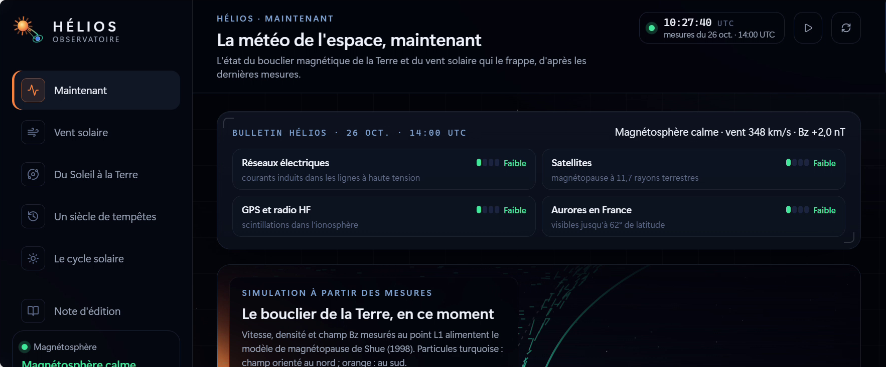<br><b>Maintenant</b> : bulletin de risques et état du bouclier | 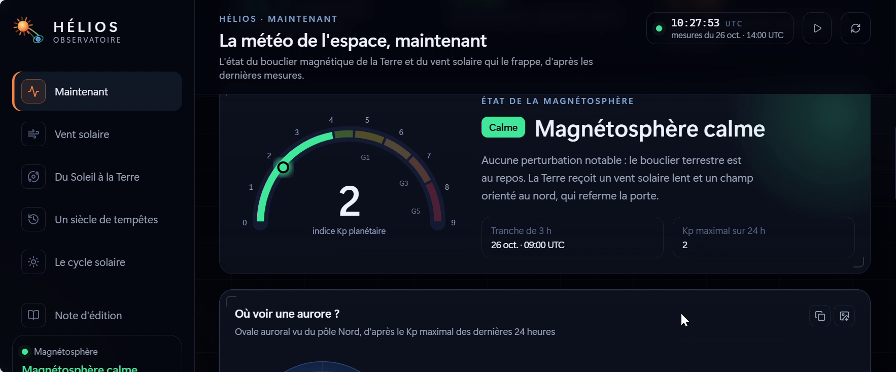<br><b>Jauge Kp</b> et ovale auroral |
| 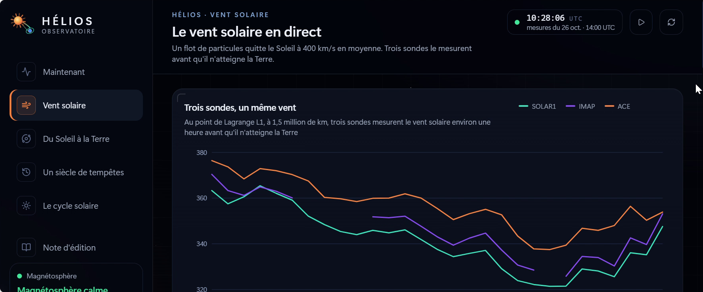<br><b>Vent solaire</b> : trois sondes, un même vent | 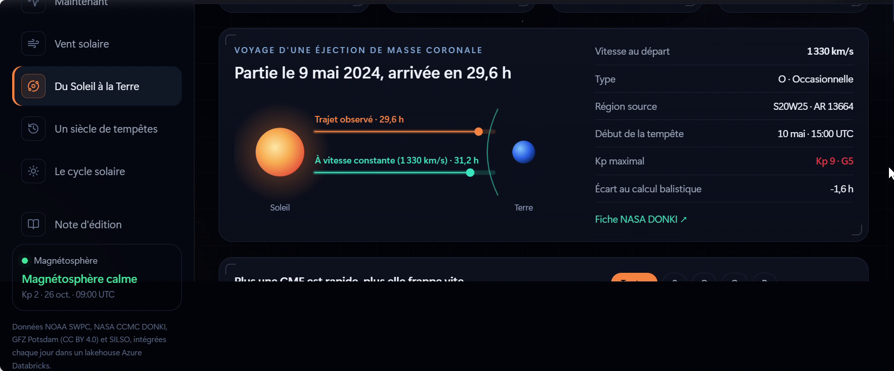<br><b>Du Soleil à la Terre</b> : voyage animé d'une éjection |
| 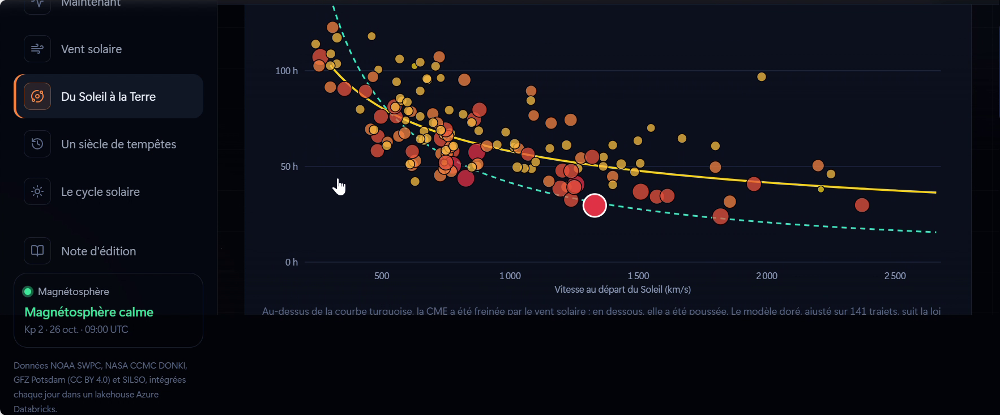<br><b>Vitesse contre trajet</b>, avec modèle ajusté | 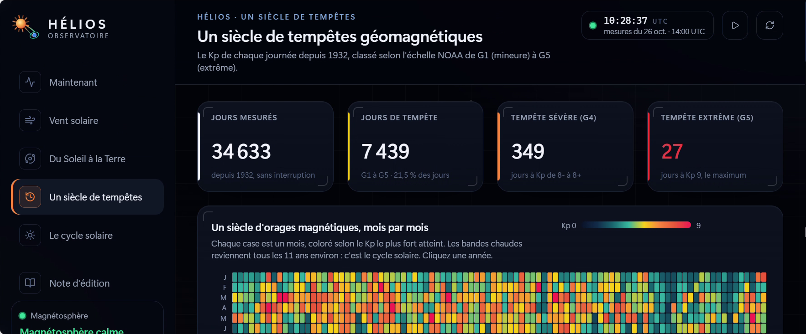<br><b>Un siècle de tempêtes</b>, mois par mois depuis 1932 |
| 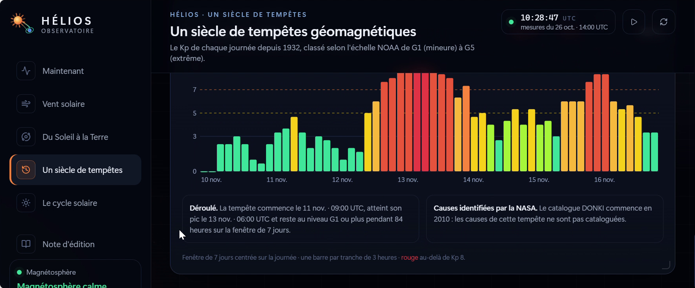<br><b>Anatomie d'une tempête</b>, ici le 13 novembre 1960 | 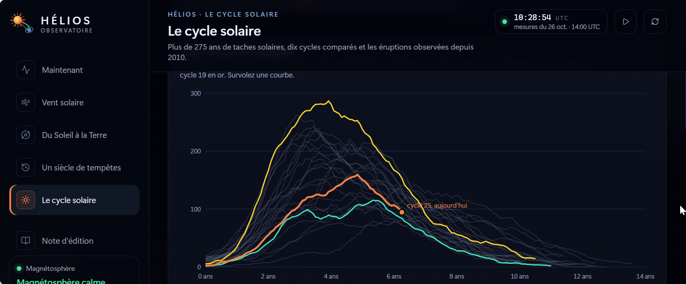<br><b>25 cycles solaires</b> superposés |

Le code, ses 12 requêtes DAX et la procédure de déploiement sont dans [`06_fabric_app/`](06_fabric_app/).

---

## 🚀 Démarrage rapide

**Prérequis** : un espace Azure Databricks Premium avec Unity Catalog et Serverless ; pour la restitution, Power BI Desktop et un espace Microsoft Fabric.

```text
1. Workspace → votre dossier → Create → Git folder → URL de ce dépôt
2. Catalog → Create → Create a catalog : helios (Use default storage)
3. SQL Editor → 00_unity_catalog/setup_unity_catalog.sql → Run all
4. 01_notebooks/01_collecteur → widgets donki_depuis = 2010-01-01, gfz = oui → Run all
5. Jobs & Pipelines → Create → ETL pipeline helios_pipeline → dossier 02_pipeline/transformations → Run pipeline
6. Jobs & Pipelines → Create → Job helios_orchestration : collecter → transformer → controler, 0 17 6 * * ?
7. 07_power_bi/HELIOS_Meteo_Spatiale.pbip → Modifier les paramètres (hôte, chemin HTTP) → Actualiser → Publier
8. 06_fabric_app → fabric.yaml (vos identifiants) → npx rayfin up
```

Chaque étape, avec son résultat attendu et son explication, est détaillée dans le [guide PDF](docs/HELIOS_guide_Databricks.pdf). Les requêtes de contrôle sont dans [`03_verifications/verifications.sql`](03_verifications/verifications.sql).

---

## 🗂️ Structure du dépôt

```text
helios-databricks/
├── 00_unity_catalog/
│   └── setup_unity_catalog.sql      schémas, volume, commentaires et tags
├── 01_notebooks/
│   ├── 00_explorer.py               regarder les sources avant de les intégrer
│   ├── 01_collecteur.py             ingestion des trois API vers le volume
│   └── 02_controle.py               contrôle de fraîcheur, dernière tâche du job
├── 02_pipeline/transformations/
│   ├── 01_bronze.py                 Auto Loader, trois streaming tables
│   ├── 02_silver_noaa.py            vent solaire, champ magnétique, Kp, rayons X, cycle
│   ├── 03_silver_gfz.py             Kp toutes les 3 heures depuis 1932
│   ├── 04_silver_donki.py           CME (SCD 2), tempêtes, éruptions
│   └── 05_gold.sql                  sept vues matérialisées
├── 03_verifications/
│   └── verifications.sql            résultat attendu de chaque étape
├── 04_gouvernance/
│   ├── gouvernance.sql              droits et tags
│   ├── qualite.sql                  qualité mesurée par les expectations
│   └── cout.sql                     coût réel par jour et par produit
├── 05_restitution/
│   ├── tableau_de_bord.sql          jeux de données du tableau de bord AI/BI
│   └── genie.md                     configuration du Genie Agent
├── 06_fabric_app/                   application Fabric Apps (React, TypeScript, DAX)
├── 07_power_bi/                     modèle sémantique (TMDL) et rapport (PBIR), format PBIP
└── docs/
    ├── HELIOS_guide_Databricks.pdf  le guide pas à pas
    ├── architecture.png · .svg
    ├── lignee.png · .svg
    ├── modele_semantique.png · .svg
    └── images/                      captures et animations
```

---

## 🛠️ Stack technique

| Domaine | Outils |
| --- | --- |
| Plateforme | Azure Databricks Premium, calcul Serverless, SQL Warehouse 2X-Small |
| Ingestion | Python, `requests`, volumes Unity Catalog, Auto Loader |
| Transformation | Lakeflow Declarative Pipelines (Python et SQL), Delta Lake, AUTO CDC (SCD 1 et 2), expectations |
| Orchestration | Lakeflow Jobs, planification cron, alertes e-mail |
| Gouvernance | Unity Catalog : droits, tags, lignée, `event_log`, tables système de facturation |
| Exploration | Tableau de bord AI/BI, Genie Agent |
| Modélisation | Power BI Desktop, projet PBIP (TMDL et PBIR), schéma en étoile, DAX, paramètres Power Query |
| Restitution | Power BI en mode Import, Microsoft Fabric (publication, OAuth2, actualisation planifiée) |
| Application | Fabric Apps, React 19, TypeScript, Vite, Tailwind CSS, graphiques SVG et canvas |

---

## 📚 Sources et licences

| Source | Données | Licence |
| --- | --- | --- |
| [NOAA Space Weather Prediction Center](https://www.swpc.noaa.gov/) | Vent solaire et champ magnétique temps réel, Kp, rayons X GOES, cycle solaire | Domaine public |
| [NASA CCMC DONKI](https://kauai.ccmc.gsfc.nasa.gov/DONKI/) | Éjections de masse coronale, tempêtes géomagnétiques, éruptions et leurs liens | Domaine public |
| [GFZ Helmholtz Centre Potsdam](https://kp.gfz.de/) | Indices Kp, ap et Ap depuis 1932 | CC BY 4.0 |
| [SILSO, Observatoire royal de Belgique](https://www.sidc.be/SILSO/) | Nombre de taches solaires depuis 1749, diffusé par la NOAA | CC BY-NC 4.0 |

Références scientifiques : Newell et al. (2007), fonction de couplage entre vent solaire et magnétosphère ; Shue et al. (1998), modèle de la magnétopause.

---

## ✅ Conclusion

HÉLIOS montre la chaîne complète d'un data engineer sur Databricks, appliquée à un sujet réel et peu exploré : des API scientifiques hétérogènes, un atterrissage traçable, un médaillon incrémental qui gère doublons et révisions, une orchestration qui se contrôle elle-même, une gouvernance qui prouve chaque chiffre, puis une restitution dans Power BI et dans une application Fabric Apps. Le tout pour un coût de construction de l'ordre d'une quinzaine de dollars.

---

## 💡 Mot de la fin

> Le 9 mai 2024, une éjection quitte le Soleil à 1 330 km/s. Vingt-neuf heures et demie plus tard, la Terre entre en tempête G5, et la nuit suivante des aurores sont vues jusqu'au Mexique. HÉLIOS relie ces deux instants, avec 94 ans d'histoire autour.
>
> **Construire pour explorer. Explorer pour comprendre. Et apprendre en chemin.**

<p align="center">
  <b>Abdoul Hamid Diallo</b> · Data &amp; AI Engineer<br>
  <a href="https://www.linkedin.com/in/abdoul-hamid-diallo-fabric-data-engineer/">LinkedIn</a> ·
  <a href="https://github.com/abdoulhamiddiallo">GitHub</a>
</p>

<p align="center"><sub>Code sous licence MIT. Données sous les licences de leurs producteurs, listées ci-dessus.</sub></p>
